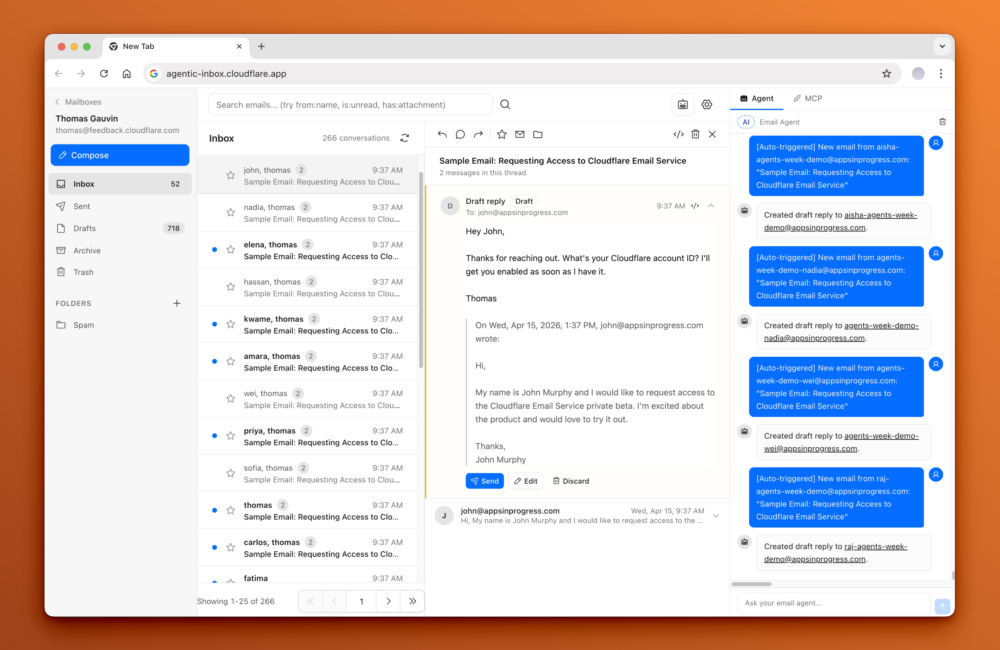

<div align="center">
  <h1>Agentic Inbox</h1>
  <p><em>A self-hosted email client with an AI agent, running entirely on Cloudflare Workers</em></p>
</div>

Agentic Inbox lets you send, receive, and manage emails through a modern web interface -- all powered by your own Cloudflare account. Incoming emails arrive via [Cloudflare Email Routing](https://developers.cloudflare.com/email-routing/), each mailbox is isolated in its own [Durable Object](https://developers.cloudflare.com/durable-objects/) with a SQLite database, and attachments are stored in [R2](https://developers.cloudflare.com/r2/).

An **AI-powered Email Agent** can read your inbox, search conversations, and draft replies -- built with the [Cloudflare Agents SDK](https://developers.cloudflare.com/agents/) and [Workers AI](https://developers.cloudflare.com/workers-ai/).




Read the blog post to learn more about Cloudflare Email Service and how to use it with the Agents SDK, MCP, and from the Wrangler CLI: [Email for Agents](https://blog.cloudflare.com/email-for-agents/).

## How to setup

**Important**: Clicking the 'Deploy to Cloudflare' button is only one part of the setup. You must follow the **After deploying** steps as well. For a full step-by-step guide with screenshots, refer to this comment: 
https://github.com/cloudflare/agentic-inbox/issues/4#issuecomment-4269118513

### To set up

1. Deploy to Cloudflare. The deploy flow will automatically provision R2, Durable Objects, and Workers AI. You'll be prompted for **DOMAINS**, a comma-separated list of the domains you want to receive emails for, such as `lisense.uk,snailbox.live`.

     [](https://deploy.workers.cloudflare.com/?url=https://github.com/cloudflare/agentic-inbox)

2. **Configure Cloudflare Access** -- Enable [one-click Cloudflare Access](https://developers.cloudflare.com/changelog/post/2025-10-03-one-click-access-for-workers/) on your Worker under Settings > Domains & Routes. The modal will show your `POLICY_AUD` and `TEAM_DOMAIN` values. `TEAM_DOMAIN` can be either your Access team URL or the full `.../cdn-cgi/access/certs` URL. **You must set these as secrets for your Worker.**
3. **Set up Email Routing** -- In the Cloudflare dashboard, go to each domain > Email Routing and create a catch-all rule that forwards to this Worker
4. **Enable Email Service** -- The worker needs the `send_email` binding to send outbound emails. See [Email Service docs](https://developers.cloudflare.com/email-routing/email-workers/send-email-workers/)
5. **Create a mailbox** -- Visit your deployed app and create a mailbox for any address on your domain (e.g. `hello@example.com`)

### Troubleshooting Access

1. If you see `Invalid or expired Access token`, that usually means `POLICY_AUD` or `TEAM_DOMAIN` secrets are incorrect.
   * Resolution: [turn Access off and back on for the Worker to get the Access modal again](https://developers.cloudflare.com/changelog/post/2025-10-03-one-click-access-for-workers/), then reset your Worker secrets to the latest `POLICY_AUD` and `TEAM_DOMAIN` values shown there.
2. If you see `Cloudflare Access must be configured in production`, this application is intentionally enforcing Cloudflare Access so your inbox is not exposed to anyone on the internet.
   * Resolution: enable Access using [one-click Cloudflare Access for Workers](https://developers.cloudflare.com/changelog/post/2025-10-03-one-click-access-for-workers/), then set the `POLICY_AUD` and `TEAM_DOMAIN` Worker secrets from the modal values.

## Features

- **Full email client** — Send and receive emails via Cloudflare Email Routing with a rich text composer, reply/forward threading, folder organization, search, and attachments
- **Per-mailbox isolation** — Each mailbox runs in its own Durable Object with SQLite storage and R2 for attachments
- **Built-in AI agent** — Side panel with 9 email tools for reading, searching, drafting, and sending
- **Auto-draft on new email** — Agent automatically reads inbound emails and generates draft replies, always requiring explicit confirmation before sending
- **Configurable and persistent** — Custom system prompts per mailbox, persistent chat history, streaming markdown responses, and tool call visibility

## Stack

- **Frontend:** React 19, React Router v7, Tailwind CSS, Zustand, TipTap, `@cloudflare/kumo`
- **Backend:** Hono, Cloudflare Workers, Durable Objects (SQLite), R2, Email Routing
- **AI Agent:** Cloudflare Agents SDK (`AIChatAgent`), AI SDK v6, Workers AI (`@cf/moonshotai/kimi-k2.5`), `react-markdown` + `remark-gfm`
- **Auth:** Cloudflare Access JWT validation (required outside local development)

## Getting Started

```bash
npm install
npm run dev
```

### Configuration

1. Set your email domains in `wrangler.jsonc` as a comma-separated `DOMAINS` string.
2. Create an R2 bucket named `agentic-inbox`: `wrangler r2 bucket create agentic-inbox`

### Multiple domains

One deployment can serve multiple email domains. This checkout configures `DOMAINS` as `"lisense.uk,snailbox.live"`. When creating a mailbox, choose its domain in the address picker. Mailboxes use their full email address, so `hello@lisense.uk` and `hello@snailbox.live` have separate messages, settings, and agents. Outbound mail uses the selected mailbox's address.

For each domain, enable [Email Routing](https://developers.cloudflare.com/email-service/configuration/email-routing-addresses/) and point a catch-all rule at the same `agentic-inbox` Worker. Also onboard each domain to [Email Sending](https://developers.cloudflare.com/email-service/configuration/domains/) and complete its DNS verification before sending from it. Updating `DOMAINS` alone does not configure Cloudflare routing or DNS.

The web app and MCP can stay at `https://mail.lisense.uk`; email domains do not need separate web app hostnames. Keep `MCP_PUBLIC_ORIGIN` set to that app origin for event and notification links. All mailboxes share the existing Cloudflare Access policy.

Incoming mail automatically creates a mailbox for its delivery address on a configured domain, then saves the first message in its inbox. For example, the first email to `new@snailbox.live` creates that mailbox. Existing mailbox settings are preserved on later deliveries.

If `EMAIL_ADDRESSES` is nonempty, include the full allowed addresses from every domain; other addresses cannot create mailboxes or receive mail. An empty list allows any address on the configured domains. If `CATCH_ALL_MAILBOX` is explicitly set, unknown addresses go to that shared mailbox instead.

Run `npm run test:multi-domain` to check mailbox isolation, delivery routing, and outbound sender selection locally without sending real mail.

### Blocking inboxes

Use the block button beside a mailbox, or **Block inbox** in its settings, to hide it and stop receiving mail. Manage blocked addresses at `/settings/blocked-inboxes`, available from the mailboxes page and mailbox settings. You can block an address before any mail arrives, and unblock it from that page later.

Blocked addresses stay out of mailbox lists, configured address lists, normal API routes, agents, and MCP operations. Incoming mail is discarded, including when automatic creation or a catch-all mailbox is configured. Discord notifications and automatic drafts stop, connected agent sessions close, and MCP event subscriptions and pending deliveries are cancelled.

Existing messages, attachments, and settings are retained. Unblocking restores access to them. Messages discarded while blocked are not recovered, and cancelled MCP subscriptions must be created again. Blocking uses a separate persistent record, so deleting or recreating mailbox settings cannot bypass the block.

Run `npm run test:blocked-inboxes` to check blocking, notification suppression, and restoration locally without sending real mail.

### Deploy

```bash
npm run deploy
```

## Prerequisites

- Cloudflare account with a domain
- [Email Routing](https://developers.cloudflare.com/email-routing/) enabled for receiving
- [Email Service](https://developers.cloudflare.com/email-service/) enabled for sending
- [Workers AI](https://developers.cloudflare.com/workers-ai/) enabled (for the agent)
- [Cloudflare Access](https://developers.cloudflare.com/cloudflare-one/policies/access/) configured for deployed/shared environments (required in production)

Any user who passes the shared Cloudflare Access policy can access all mailboxes in this app by design. This includes the MCP server at `/mcp` -- external AI tools (Claude Code, Cursor, etc.) connected via MCP can operate on any mailbox by passing a `mailboxId` parameter. There is no per-mailbox authorization; the Cloudflare Access policy is the single trust boundary.

### MCP OAuth

Enable [Managed OAuth](https://developers.cloudflare.com/cloudflare-one/access-controls/applications/http-apps/managed-oauth/) on the self-hosted Access application under Advanced settings. Enable dynamic client registration and allow the intended client's callback URI. Local CLI clients use localhost or loopback callbacks; hosted clients need their HTTPS callback explicitly allowed. Connect an OAuth-capable MCP client to `https://<your-app-domain>/mcp` using Streamable HTTP.

Access handles OAuth discovery, login and tokens. The Worker continues validating `Cf-Access-Jwt-Assertion` using `TEAM_DOMAIN` and `POLICY_AUD`. Keep the MCP URL covered by the Access application whose audience the Worker validates.

Run a read-only discovery check:

```bash
node scripts/check-mcp-oauth.mjs https://<your-app-domain>/mcp
```

This checks the OAuth challenge and metadata, PKCE and refresh support. Complete login in the intended client and call `list_mailboxes` to verify authenticated MCP access. If Cloudflare security blocks the request before OAuth, check Browser Integrity Check and relevant WAF rules. See [the OAuth investigation](docs/mcp-oauth-research.md) for the verified live configuration and remaining checks.

### MCP Events

ChatGPT can monitor `email.received` and react to new mail. Subscriptions require a mailbox address and can filter by exact sender or subject text. The server verifies callbacks, signs webhooks, and persists subscriptions and delivery retries in each mailbox's Durable Object.

After deploying, rescan your ChatGPT plugin, then use a Work chat on the web or Work with Cloud in the desktop app. Try: "Watch hello@lisense.uk for new emails with invoice in the subject and summarize each one."

Set `MCP_PUBLIC_ORIGIN` to your Access-protected app origin and `MCP_EVENTS_CALLBACK_HOSTS` to the exact OpenAI callback hostnames you permit. See [MCP Events setup and delivery behavior](docs/mcp-events.md). Run `npm run test:mcp-events` to verify the implementation locally.

## Architecture

```
┌──────────────┐     ┌──────────────────┐     ┌─────────────────┐
│   Browser    │────>│  Hono Worker     │────>│  MailboxDO      │
│  React SPA   │     │  (API + SSR)     │     │  (SQLite + R2)  │
│  Agent Panel │     │                  │     └─────────────────┘
└──────┬───────┘     │  /agents/* ──────┼────>┌─────────────────┐
       │             │                  │     │  EmailAgent DO  │
       │ WebSocket   │                  │     │  (AIChatAgent)  │
       └─────────────┤                  │     │  9 email tools  │
                     │                  │────>│  Workers AI     │
                     └──────────────────┘     └─────────────────┘
```

## License

Apache 2.0 -- see [LICENSE](LICENSE).

### Inbox management and automatic reply drafting

MCP clients can use `create_mailbox` with `email` and `name`, and `delete_mailbox` with `mailboxId`. Creation respects `EMAIL_ADDRESSES`. Removing an inbox retains its stored messages and attachments, which reappear if the same address is recreated.

Automatic reply drafting defaults to enabled. Turn it off per inbox in Settings by clearing "Automatically draft replies" and saving. Incoming mail is still stored and manual drafting remains available. Existing drafts are kept.

### Additional MCP email tools

- `search_emails` accepts optional `query`, `folder`, `from`, `to`, `subject`, `date_start`, `date_end`, `is_read`, `is_starred`, `has_attachment`, `page`, and `limit`. Dates are ISO 8601 timestamps. Results now contain `emails`, `totalCount`, `page`, and `limit` rather than a bare array. Page size defaults to 25 and is capped at 100.
- `get_attachment` takes `mailboxId`, `emailId`, and `attachmentId` from `get_email`. It returns file metadata and an embedded MCP resource with base64 file content. Files above 5 MiB must be downloaded through the app.
- `list_folders` returns folder IDs, names, and unread counts. `create_folder` takes a display `name` and returns an ID usable with `move_email`.
- `mark_thread_read` takes `threadId` and marks every message in the conversation read. `star_email` takes `emailId` and a `starred` boolean.
- `forward_email` takes `emailId`, `to`, optional `bodyHtml` for a note, and `includeAttachments`, which defaults to true. It includes the original message, starts a new conversation, and sends from the selected mailbox. Combined attachment size is capped at 25 MiB. Use it only after the user confirms sending.

Run `npm run test:mcp-tools` for the mailbox operation integration checks and `npm run test:mcp-events` for event and discovery checks. Tests use a sender stub and do not send real email.
